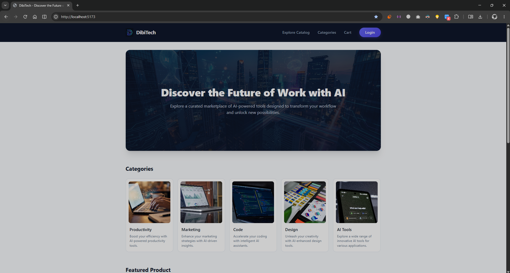
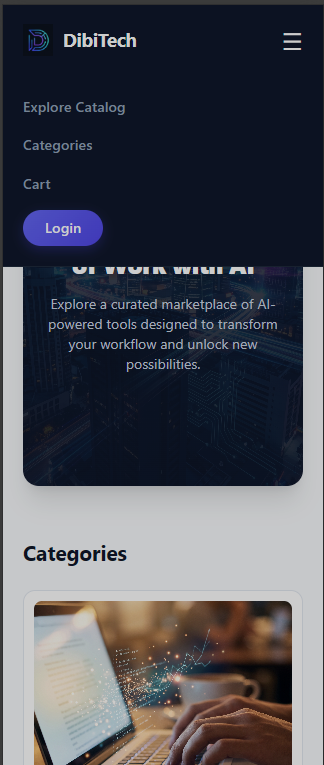

# Mini-Project Day 26: DibiTech — React Styling Mini Project

## Profil

- **Nama:** Ilham Dwi Putranto
- **Kelas:** Full-Stack Web Development
- **GitHub:** [ilhamdwiputranto](https://github.com/ilhamdwiputranto)
- **LinkedIn:** [Ilham Dwi Putranto](https://www.linkedin.com/in/ilham-dwi-putranto)

---

Proyek ini memindahkan halaman utama marketplace DibiTech, yang sebelumnya di buat dengan HTML dan CSS biasa, ke React dengan Tailwind CSS.

---

## Teknologi

- React + Vite
- Tailwind CSS

---

## Struktur Folder

```
dibitech-react-styling/
├── public/
│ └── images/
├── src/
│ ├── components/
│ │ ├── Card.jsx
│ │ ├── FeaturedCard.jsx
│ │ ├── Footer.jsx
│ │ ├── Header.jsx
│ │ ├── Hero.jsx
│ │ └── ProductSection.jsx
│ ├── data/
│ │ └── items.js
│ ├── App.jsx
│ ├── index.css
│ └── main.jsx
├── index.html
├── package.json
├── postcss.config.js
├── tailwind.config.js
└── vite.config.js`
```

---

## Komponen

Pada tugas ini, halaman utama disusun ke dalam komponen dan tiap bagian memiliki peran yang jelas:

- `Header.jsx` — Navigasi utama, logo, dan toggle menu untuk layar kecil.
- `Hero.jsx` — Bagian banner utama dengan judul dan deskripsi yang dikirim lewat `props`.
- `ProductSection.jsx` — Membungkus judul bagian (_Categories_ dan _Trending_) serta mengatur layout grid.
- `Card.jsx` — Komponen kartu untuk menampilkan gambar, judul, deskripsi, dan harga dari data yang dipassing.
- `FeaturedCard.jsx` — Bagian produk unggulan dengan data yang dikirim melalui `props`.
- `Footer.jsx` — Navigasi bawah, tautan media sosial, dan informasi hak cipta.
- `src/data/items.js` — Menyimpan data statis untuk daftar kategori dan item trending.

---

## Alur data

Data kategori dan trending ada di `src/data/items.js`. `App.jsx` mengimpornya
dan mengirim ke `ProductSection` lewat props `items`. Di sana dipetakan
lagi menjadi beberapa `Card`.

---

## Cara menjalankan

1. Pastikan asset gambar ada di folder `public/images/`
2. Instal seluruh dependensi:
   ```bash
   npm install
   ```
3. Jalankan:
   ```bash
   npm run dev
   ```

---

## Kesesuaian kriteria

- [x] 1 halaman utama tanpa React Router
- [x] Pemecahan komponen
- [x] Styling dengan Tailwind
- [x] Penggunaan props

---

## Tampilan

Desktop:


Mobile:


